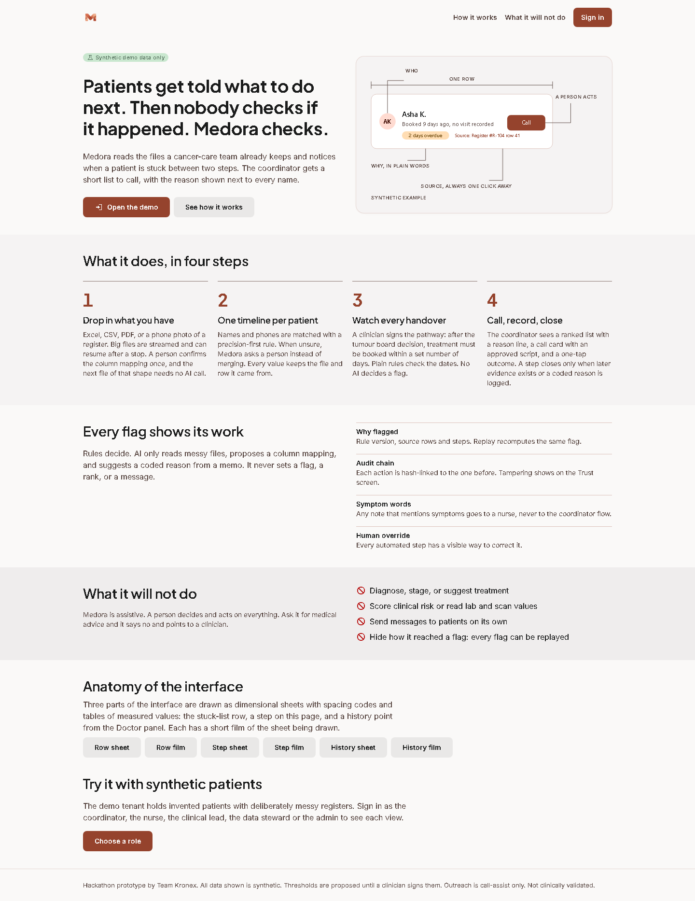
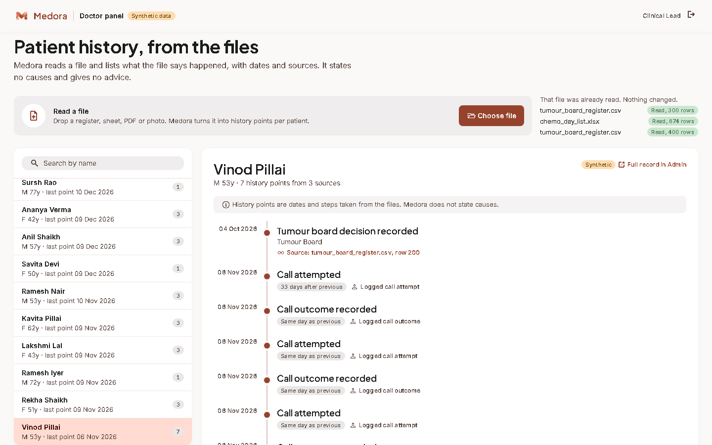
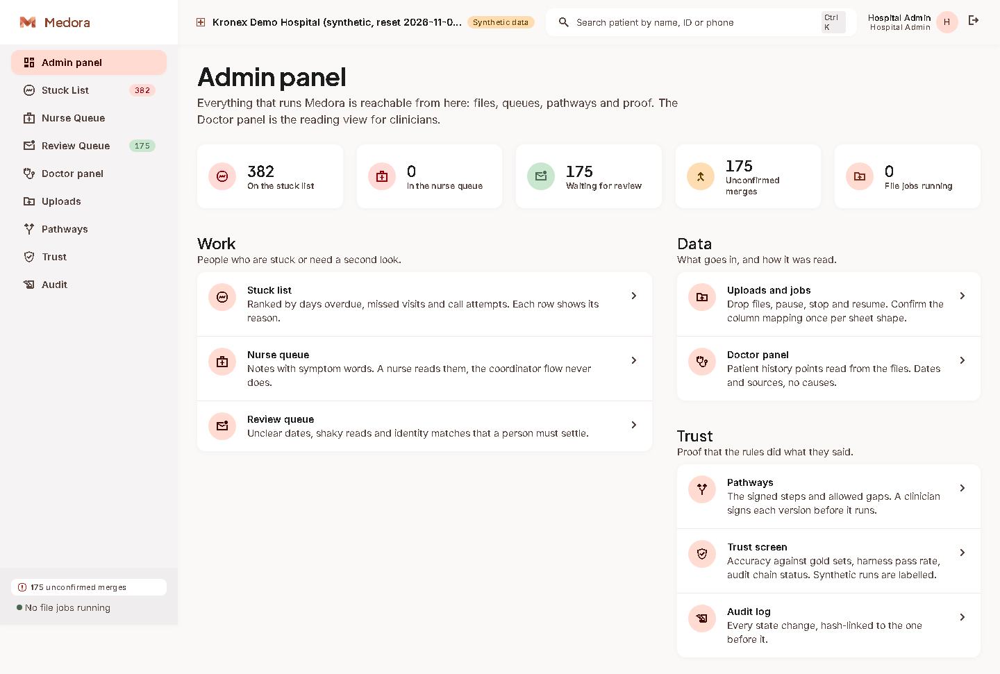
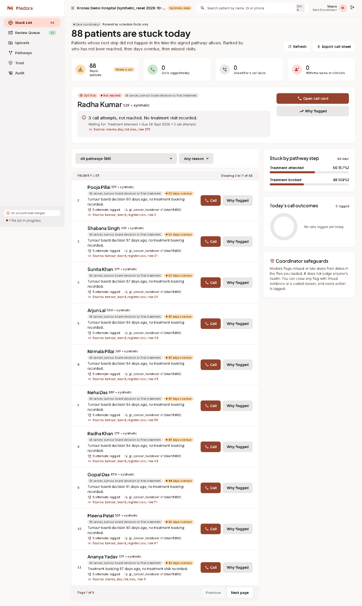
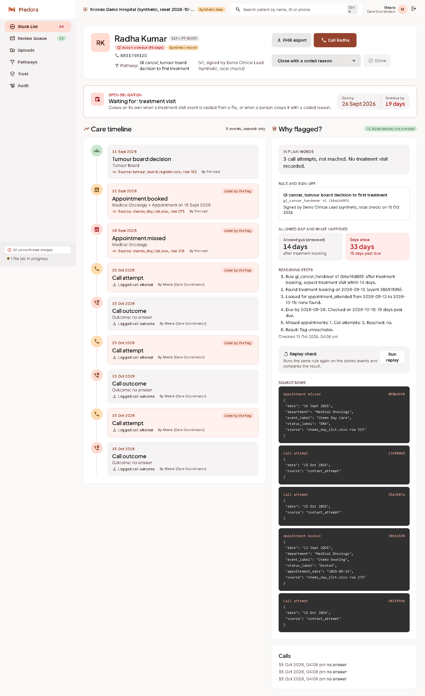
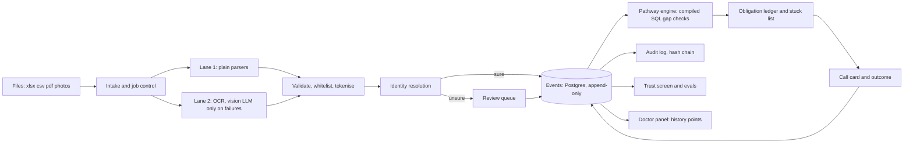

<p align="center">
  
</p>

<p align="center"><b>Patients get told what to do next. Then nobody checks if it happened. Medora checks.</b></p>

<p align="center">
  
  
  
  
</p>

<p align="center"></p>

---

## A Tuesday at the cancer centre

Meera is a care coordinator. On the first of the month a tumour board decided that a patient should start treatment. Somebody wrote that decision in the register. Then the register went quiet. No booking, no visit, no line at all.

Nobody did anything wrong. The decision lived in one sheet, the appointment book lives in another, and the phone numbers are in a third that someone photographed on their phone. Nine days later the patient is still waiting for a call that no one knows they owe her.

Medora reads those sheets the way a careful colleague would. It lines up each patient's dates, notices the step that should have followed and didn't, and puts her on a short list with one plain sentence next to her name: *"Booked 9 days ago, no visit recorded."* Click the name and you see the rule, the rows it came from and the dates it counted. Then Meera makes the call, and Medora writes down what happened.

That is the whole product. It is a follow-up checker with a good memory and no opinions about medicine.

## What it does

1. **Reads what you already have.** Excel, CSV, PDF, or a phone photo of a register. Big files stream in chunks and can be stopped and resumed. A person confirms the column mapping once per sheet shape, and the next file of that shape needs no AI call.
2. **Builds one timeline per patient.** Names and phones are matched with a precision-first rule. When it is unsure it asks a person instead of merging. Every value remembers the file and row it came from.
3. **Watches every handover.** A clinician signs a pathway: after the tumour board decision, treatment must be booked within a set number of days. Plain rules check the dates. No AI decides a flag.
4. **Helps the call happen.** A ranked list with a reason line, a call card with an approved script, and a one-tap outcome. A step closes only when later evidence exists or a coded reason is logged.

## Who sits where

| Panel | Who | What they do there |
|---|---|---|
| **Admin panel** | Hospital admin | The main control room. Files and jobs, queues, pathways, trust screen, audit log. Everything else is one click away. |
| **Doctor panel** | Clinical lead | Drops a file and reads each patient's history points: dated steps taken from the files, with sources. No causes, no advice. |
| Coordinator view | Meera | Stuck list, patient timeline with why-flagged, call card on a phone. |
| Nurse queue | Nurse | Notes that mention symptoms land here and nowhere else. |
| Data steward | Data steward | Mapping confirmation and the review queue. |

<table>
  <tr>
    <td width="50%"><br><sub>Doctor panel: history points from the files.</sub></td>
    <td width="50%"><br><sub>Admin panel: the control room.</sub></td>
  </tr>
  <tr>
    <td><br><sub>Stuck list with a reason on every row.</sub></td>
    <td><br><sub>Timeline and the why-flagged panel.</sub></td>
  </tr>
</table>

## What it will not do

Medora does not diagnose, stage, suggest treatment, score clinical risk or read lab and scan values. It does not message patients on its own. If you ask it for medical advice it says no and points to a clinician. A person can override every automated step, and every override is logged.

The doctor panel follows the same rule. A history point says that a visit was missed on 12 October. It never says why.

## How it works



Three habits shape the code. **Rules decide, language models read:** an LLM may extract a field, propose a mapping or suggest a reason code, and never sets a flag, a rank or a message. **Fail closed:** any error, low confidence or schema violation goes to a person. **One database:** Postgres holds the events, the job queue and the workflow checkpoints.

The full spec is in [PRD.md](PRD.md). The hard limits are in [Rules.md](Rules.md). A feature-by-feature check of the build is in [docs/PRD_CHECK.md](docs/PRD_CHECK.md).

## Set it up

You need Python 3.11 or newer, [uv](https://docs.astral.sh/uv/), and Node 22. On Windows, run the shell scripts from Git Bash.

### Fastest path: local Postgres, no accounts

```bash
git clone <this repo> && cd Medora
cd api && uv sync --all-extras && cd ../web && npm ci && cd ..

# starts a local Postgres (data/pg, git-ignored) and prints the env lines
eval "$(uv run --project api python scripts/local_pg.py)"

(cd api && uv run alembic upgrade head)
uv run --project api python scripts/demo_reset.py --signed-by "Dr. Your Name (synthetic)"

(cd api && uv run uvicorn medora.app:app --port 8000) &
uv run --project api python worker/worker.py &
(cd web && npm run dev)
```

Open <http://localhost:3000/welcome> for the landing page, or <http://localhost:3000/login> to sign in. The name you pass to `--signed-by` is recorded as the clinician who signed the demo pathway. Claude Code never signs.

### With Supabase

1. Create a free project in the Mumbai region.
2. `cp .env.example .env` and fill it in:
   - `DATABASE_URL`: the **session pooler** (port 5432) as the `medora_app` role. Never the transaction pooler on 6543.
   - `MIGRATION_DATABASE_URL`: the same pooler as `postgres.[project-ref]`, used only by migrations.
   - `MEDORA_APP_PASSWORD` and `JWT_SECRET` (32 or more characters).
   - Optional: `LLM_*`, `VISION_MODEL`, `ASR_*` for any OpenAI-compatible provider. With no key set, every LLM step fails closed to a person.
3. `scripts/seed.sh "Dr. Your Name"` migrates and loads the demo tenant, then `scripts/dev.sh` starts the API, the worker and the web app.

Turn the Supabase Data API off or enable row level security. The app only ever connects as the limited `medora_app` role.

### Demo accounts

All accounts use the password `medora-demo` (or `SEED_PASSWORD`). They are synthetic.

| Sign in as | Email | Lands on |
|---|---|---|
| Hospital admin | admin@medora.test | Admin panel |
| Clinical lead (doctor) | lead@medora.test | Doctor panel |
| Care coordinator | meera@medora.test | Stuck list |
| Nurse | nurse@medora.test | Nurse queue |
| Data steward | steward@medora.test | Uploads |

### Try it with pseudo data

```bash
uv run --project api python scripts/gen_pseudo.py     # data/pseudo: CSV, XLSX, three register photos, truth files
```

Sign in as the clinical lead, open the Doctor panel, drop `data/pseudo/tumour_board_register.csv` on "Read a file", then open any patient. The generator covers on-time, late, missed, silent and not-yet-due patients, and corrupts the sheets with typos, swapped day and month, Devanagari names and duplicates. Everything it writes is labelled synthetic.

## Check your work

```bash
cd api && uv run pytest -q                              # 65 tests, embedded Postgres
uv run --project api python safety_harness/run.py       # every tricky message must reach a person
uv run --project api python eval/run_eval.py            # gold sets against the proposed bars
uv run --project api python scripts/bench.py            # 10k and 100k row MVP benchmark
cd web && npm run lint && npx tsc --noEmit              # TypeScript strict
```

## Where things live

| Path | What |
|---|---|
| `api/` | FastAPI app (package `medora`), migrations, tests |
| `worker/` | Plans uploads and processes chunks with SKIP LOCKED |
| `web/` | Next.js and TypeScript. Admin panel, doctor panel, coordinator and nurse screens, landing page |
| `pathways/` | Pathway YAML. Two-key files, signed by a clinician before they run |
| `prompts/` | Versioned LLM prompts and output schemas |
| `config/` | Field whitelist, tripwire, call templates, settings |
| `safety_harness/` | Tricky messages and the runner that gates CI |
| `eval/` | Gold-set runner and baseline |
| `design/` | Stitch tokens and screens, plus dimensional drawings and films of the components |
| `docs/` | Eval reports, the PRD check, README images |

## Honest status

- Every patient, phone number and file in this repo is synthetic and labelled that way.
- Gap thresholds, call scripts and the symptom list are **proposed** until the Clinical Lead signs them. Safety harness cases are drafts until a clinician approves them.
- Outreach is call-assist only. WhatsApp and SMS sending is not built.
- Benchmarks are MVP runs at 10k and 100k rows. Anything larger is a production target, not a result.
- Not clinically validated. Not a medical device.

Team Kronex, Cancer Care track, Health-a-thon 2026.
